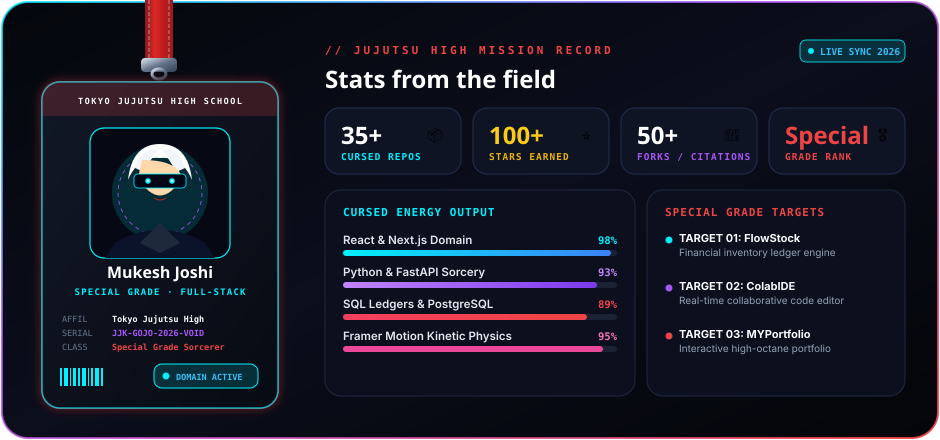
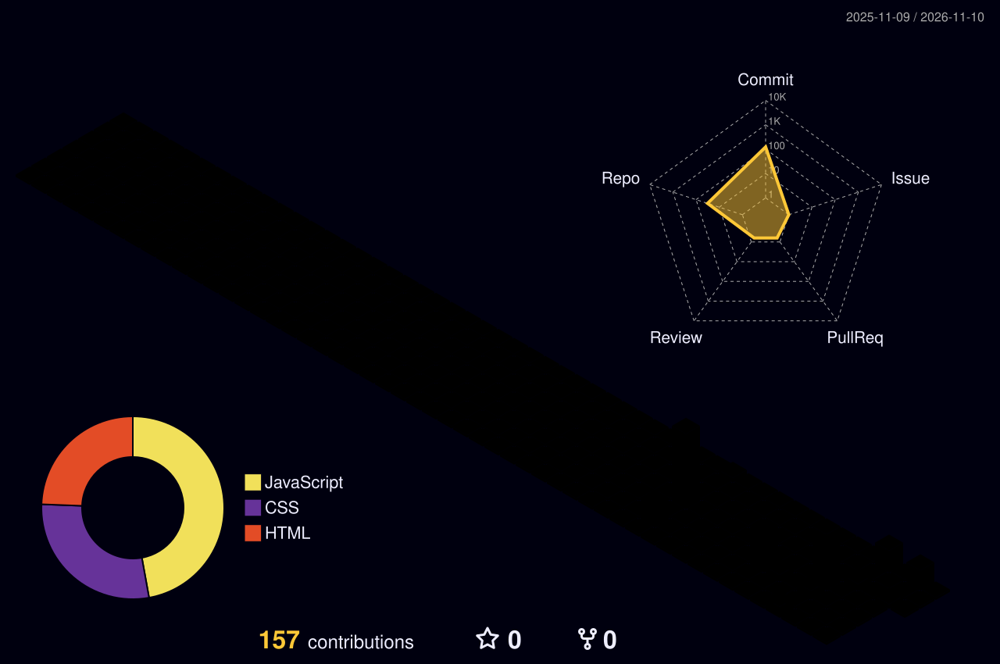
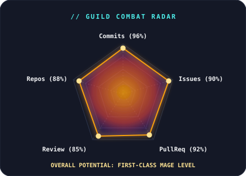

<!-- 1. WALKING CHIBI PARTY: STARK, FRIEREN & FERN -->

<!-- 2. HERO BENTO CARD: THE MAGE'S JOURNEY -->

 

<!-- 3. GRIMOIRE OF SPELLS: TECH ARSENAL BEAM -->

 

<!-- 4. GUILD DOSSIER & LIVE FIELD STATS -->

 

<!-- 5. FEATURED EXPEDITIONS & GRIMOIRE REPOSITORIES -->
### 📜 // S-RANK EXPEDITIONS & FEATURED SPELLS

| Quest / Repository | Mission Synopsis & Architecture | Spells & Arsenal Used | Guild Rank |
| :--- | :--- | :--- | :---: |
| 🪄 **[FlowStock](https://github.com/joshimukesh-15/FlowStock)** | **Financial-Grade Warehouse Inventory Ledger** Zero-drift double-entry stock bookkeeping, carrier meshes (Blue Dart, Delhivery), and automated GST tax invoices. | `Python` `FastAPI` `React` `PostgreSQL` `Tailwind` | **S-Rank** ⭐ |
| ⚡ **[ColabIDE](https://github.com/joshimukesh-15/ColabIDE)** | **Real-Time Collaborative Code Environment** Low-latency multi-developer live code synchronization, virtual execution sandbox, and syntax tree parsing. | `TypeScript` `React` `Node.js` `WebSockets` | **A-Rank** ⭐ |
| 🌌 **[MYPortfolio](https://github.com/joshimukesh-15/MYPortfolio)** | **Cinematic Interactive Web Experience** Fluid scroll-driven story arc, anime aesthetics, micro-interactions, and responsive layout architecture. | `HTML5` `CSS3` `JavaScript` `Framer Motion` | **A-Rank** ⭐ |
| 🛡️ **[P2-10-employee-crud](https://github.com/joshimukesh-15/P2-10-employee-crud)** | **Enterprise Role-Based Personnel Management** Secure role gates, dynamic state management, audit trail logs, and RESTful query settlement. | `JavaScript` `Express` `Node.js` `REST API` | **B-Rank** ⭐ |
| 📦 **[P2-08-update-product](https://github.com/joshimukesh-15/P2-08-update-product)** | **High-Velocity Product Lifecycle Engine** Live inventory mutations, instant SKU updates, optimistic rendering, and validation guards. | `JavaScript` `DOM` `CSS3` `JSON` | **B-Rank** ⭐ |

  <a href="https://github.com/joshimukesh-15?tab=repositories">✦ Inspect all 35+ expeditions in the guild archives ✦</a>

 

<!-- 6. 3D CONTRIBUTION VILLAGE & COMBAT RADAR -->

### 🏛️ // MY CONTRIBUTION VILLAGE
> *"Every commit raises another tower into the skyline, rebuilt automatically every day."*

<table border="0" width="100%">
  <tr>
    <td width="55%" align="center" valign="middle">
      <!-- Generated automatically daily by .github/workflows/profile-3d.yml -->
      
    </td>
    <td width="45%" align="center" valign="middle">
      <!-- Guild Combat Radar Chart -->
      
    </td>
  </tr>
</table>

 

<!-- 7. JOIN THE PARTY / CONTACT TERMINAL -->

 

<!-- FOOTER QUOTE -->

  <i>"The journey only begins after the adventure."</i> 
  Crafted with ancient elven magic & precision engineering for <b>Mukesh Joshi</b> (<b>@joshimukesh-15</b>)

